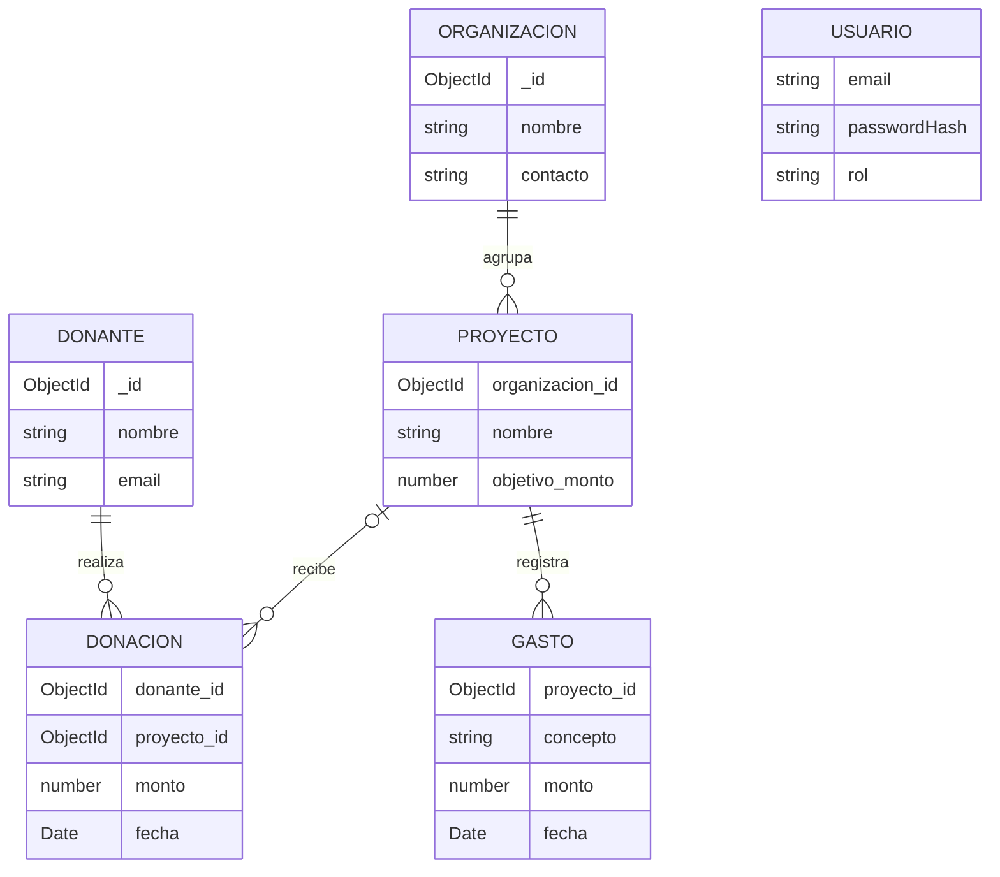
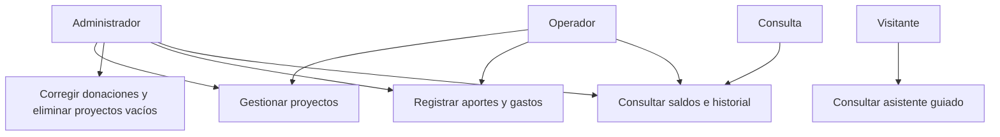
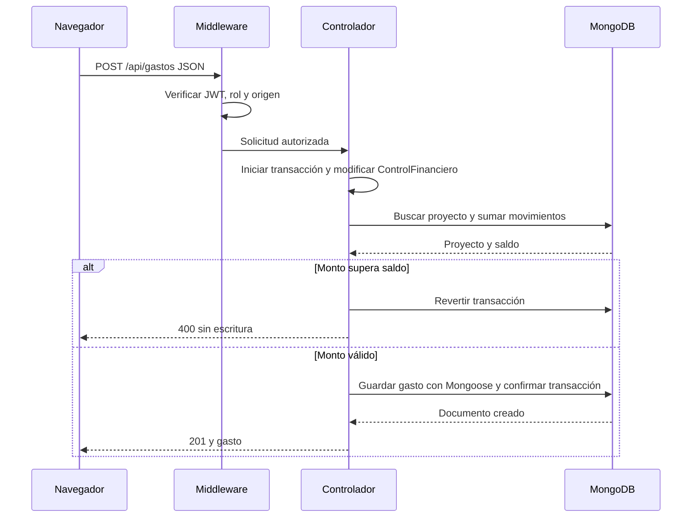

# Diagramas de tercera entrega
## Modelo de datos

Usuario autoriza acceso; no se guarda autor_id en movimientos. No existe auditoría por usuario. Las relaciones se validan en controladores porque MongoDB no aplica claves foráneas por sí solo.

## Casos de uso / permisos

## Secuencia: registrar gasto

ControlFinanciero es un documento técnico compartido con revision; no contiene saldo. La transacción usa el contexto de sesión de Mongoose. Se ejecutan consultas en orden y se devuelve HTTP después del commit. Ver services/finanzas.js.
